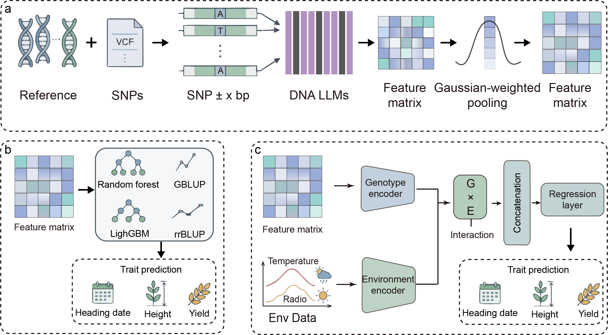

# Genomic prediction with sequence embeddings

This repository contains the core code for genomic prediction using raw SNP
features, sequence-based embeddings, perturbation analyses, and environmental
time-series representations.

## Architecture

The project workflow is organized as follows:

- `scripts/embedding/`: extract SNP-centered sequence embeddings from a
  reference FASTA using Evo2, DNABERT-2, PlantCAD, or AgroNT.
- `scripts/prediction/`: prepare feature matrices, apply PCA, train genomic
  prediction models, and summarize cross-validation results.
- `scripts/perturbation/`: evaluate the contribution of embedding windows and
  SNP selections by masking or reweighting features.
- `scripts/environment/`: process environmental time-series data, learn
  BiLSTM environmental representations, combine them with genomic features,
  and perform genotype-by-environment prediction.
- `config/`: public configuration templates with placeholders only.
- `figure/`: project architecture figure.

## Data and privacy

The repository contains code and templates only. Reference genomes,
genotypes, phenotypes, environmental data, model checkpoints, sample IDs,
analysis outputs, cluster scripts, and machine-specific paths are excluded.
Provide input and output paths through command-line arguments or local config
files when running the scripts.

See the README files inside each `scripts/` subdirectory for the corresponding
workflow details.
